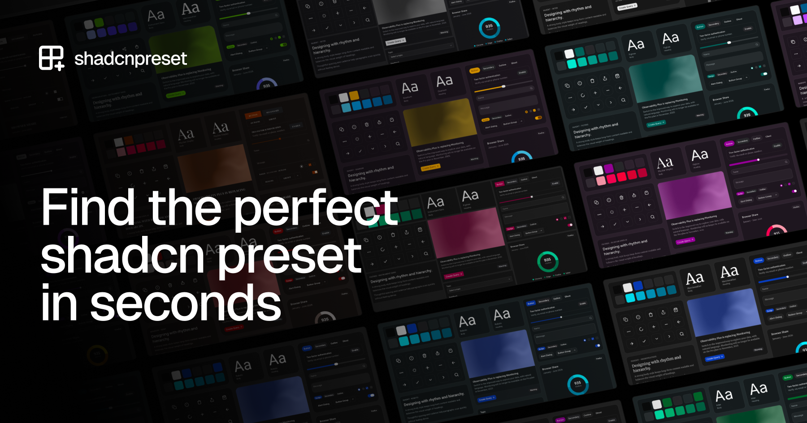

<p align="center">
  
</p>

<h1 align="center">shadcnpreset</h1>

<p align="center">
  Free & open-source platform for discovering, generating, previewing, and working with shadcn/ui presets & themes.<br/>
  Describe what you're building. AI surfaces matching presets, shows real components, and helps you choose fast.
</p>

<p align="center">
  <a href="https://github.com/morganfeeney/shadcnpreset"></a>
  <a href="https://x.com/morganfeeney"></a>
  <a href="https://vercel.com/open-source-program"></a>
</p>

<p align="center">
  <a href="https://shadcnpreset.com">Get Started</a> ·
  <a href="https://shadcnpreset.com/tools">Tools</a> ·
  <a href="https://shadcnpreset.com/community">Community</a>
</p>

## Features

- ✨ **AI-powered discovery**: describe the look and feel or the product you're building, and get matching presets
- 🖥️ **Preview presets on real UI**: dashboards, auth screens, marketing pages and more, rendered in every shadcn/ui style
- 🧱 **Page builder**: describe a page and get it assembled from blocks, in a preset you can swap
- ♿ **Accessibility-first**: browse high-contrast presets and check colour contrast
- 🛠️ **Developer tools**: preset CSS generator, contrast checker, image filter generator and a Figma variables plugin
- ❤️ **Community-driven**: vote, save favourites and share preset URLs
- 📦 **Built on shadcn/ui**: presets use shadcn's own encoding, and previews use its styles and components

## Repository structure

| Path | Description |
|------|-------------|
| `apps/shadcnpreset` | The Next.js site: discovery, previews, tools, auth and voting |
| `apps/figma-preset-plugin` | Figma variables plugin |

## Development

You'll need Node.js 20.9+ and pnpm 10 (`corepack enable` picks up the version pinned in `package.json`).

```bash
pnpm install
cp apps/shadcnpreset/.env.example apps/shadcnpreset/.env.local
pnpm dev   # http://localhost:4010
```

[`.env.example`](./apps/shadcnpreset/.env.example) documents every variable. Sign-in and voting need `DATABASE_URL` and the auth keys. Smart search needs `OPENAI_API_KEY`, and `/describe` and the page builder need `JEV_API_KEY`.

Other useful commands, run from the repo root:

```bash
pnpm test        # Vitest
pnpm lint
pnpm typecheck
```

### Updating from shadcn/ui

Previews render inside the app using shadcn/ui's style CSS, themes and components, which are copied into the repo. To update them from the latest [shadcn-ui/ui](https://github.com/shadcn-ui/ui) `main`:

```bash
pnpm sync:v4-vendor                          # style CSS and themes
pnpm --filter=shadcnpreset sync:cn-ui        # components/cn-ui
```

Each command clones only the files it needs into a temp folder and prints the upstream commit it synced from, so you don't need a local checkout. To sync from your own checkout instead, set `SHADCN_UI_PATH`. Review the diff before committing.

## Contributing

Contributions are welcome! Please see the [Contributing Guide](./CONTRIBUTING.md).

## License

Licensed under the [MIT License](./LICENSE.md).

Copyright (c) 2026 Morgan Feeney
